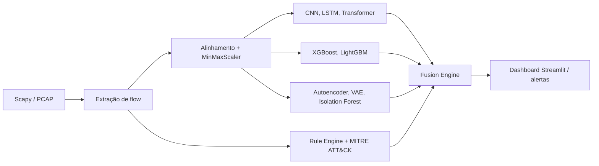

# AI-BASED NIDS

Sistema híbrido de detecção de intrusão de redes (NIDS) para flows compatíveis
com o CIC-IDS2017. O projeto combina classificação supervisionada, detecção
não supervisionada de anomalias e regras determinísticas associadas ao MITRE
ATT&CK. A saída é um score de risco entre 0 e 100, adequado para triagem em
um SOC.

## Arquitetura



O `FlowFeatureExtractor` transforma pacotes em atributos estatísticos. O
`FeatureAligner` mantém a mesma ordem das 70 colunas do benchmark. O motor de
fusão normaliza cada contribuição para `[0, 1]`, aplica override para regras
determinísticas de alta confiança e limita o resultado final a 100.

## Modelos disponíveis

| Grupo | Modelos | Finalidade |
|---|---|---|
| Supervisionado | CNN 1D residual, LSTM, Transformer | Ataques conhecidos em dados tabulares |
| Supervisionado | XGBoost, LightGBM | Gradient Boosting eficiente para flows |
| Anomalia | Autoencoder, VAE | Erro de reconstrução e sinais de zero-day |
| Anomalia | Isolation Forest | Outliers aprendidos com tráfego benigno |
| Determinístico | `RuleEngine` | SYN/Xmas scan, DoS e assinaturas web |

As arquiteturas e artefatos são descritos em
[`models/architectures.py`](models/architectures.py) por meio do
`MODEL_REGISTRY`, que permite incluir novos modelos sem espalhar nomes de
arquivos pelo pipeline.

## Instalação

```powershell
python -m venv .venv
.venv\Scripts\Activate.ps1
pip install -r requirements.txt
```

No Windows, a captura ao vivo requer Npcap. Para executar apenas análise de
PCAP, não é necessário configurar uma interface de captura.

## Treinamento local

O dataset existente em `dataset/CIC-IDS2017/` é preservado. Caso seja
necessário obter outras fontes, use o gerenciador de datasets sem colocar
tokens ou arquivos de credenciais no repositório.

```powershell
python models\train_local.py
```

O pipeline carrega CSV/Parquet, alinha as colunas, ajusta o scaler e treina os
classificadores supervisionados. Em seguida usa somente amostras benignas
para o Autoencoder, o VAE e o Isolation Forest. Os artefatos são gravados em
`models/`, incluindo:

```text
models/
├── cnn_model.h5
├── scaler.joblib
├── gradient_boosting/
│   ├── xgboost.joblib
│   └── lightgbm.joblib
├── autoencoder/{autoencoder.h5,threshold.txt}
├── vae/{vae.h5,threshold.txt}
├── isolation_forest/isolation_forest.joblib
├── lstm/lstm_model.h5
└── transformer/transformer_model.h5
```

XGBoost e LightGBM são dependências opcionais em tempo de execução: se uma
delas não estiver disponível, o treinamento informa a ausência e mantém os
demais modelos.

## Inferência e dashboard

Para captura local de tráfego:

```powershell
python realtime_detector\detector.py
```

Para abrir o console do SOC:

```powershell
streamlit run dashboard\app.py
```

O detector agrupa pacotes em flows, calcula as regras, executa todos os
artefatos encontrados e envia as contribuições ao `FusionEngine`. Os níveis
de alerta permanecem `Low`, `Medium`, `High` e `Critical`; os status internos
continuam `Normal`, `Suspicious` e `Malicious/Attack`.

## Estrutura principal

```text
data_pipeline/       carregamento, alinhamento e normalização
feature_extractor/   atributos estatísticos de flows
fusion_engine/       fusão, regras e feedback de analistas
models/               registro, treinamento e artefatos
realtime_detector/   captura e inferência local
dashboard/            console Streamlit
dataset/CIC-IDS2017/ benchmark local
```

## Segurança

Não versionar `kaggle.json`, tokens, chaves ou credenciais. Prefira variáveis
de ambiente e arquivos fora do diretório do projeto. Antes de compartilhar
logs, remova endereços IP e outros dados operacionais sensíveis.
